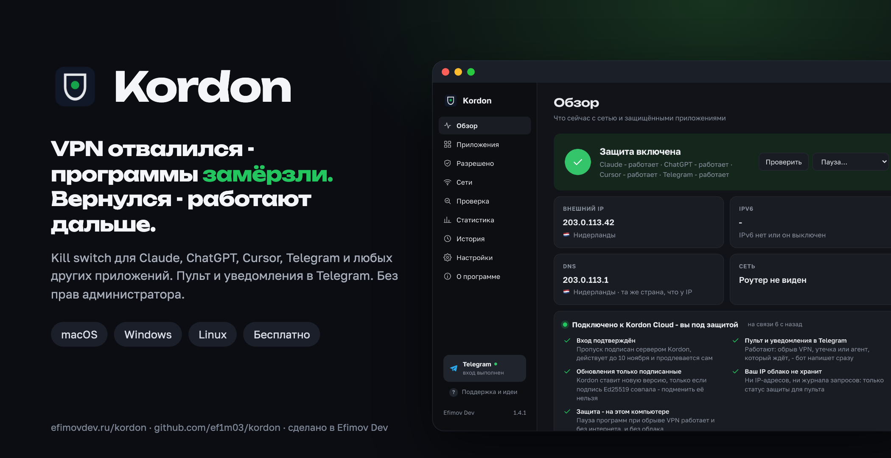
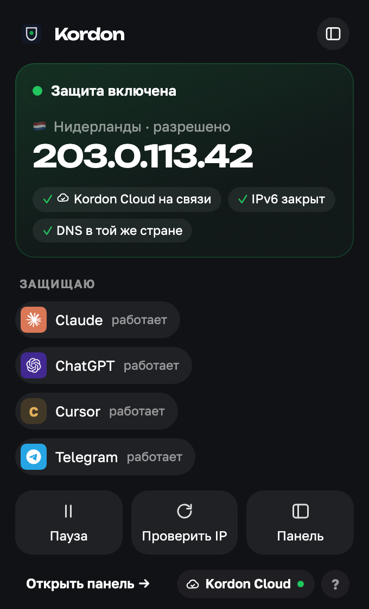
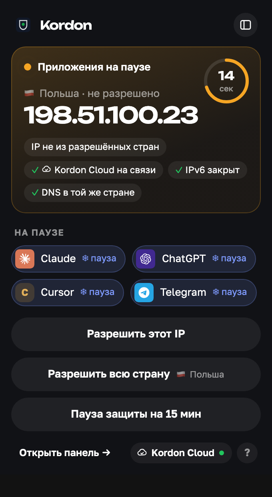
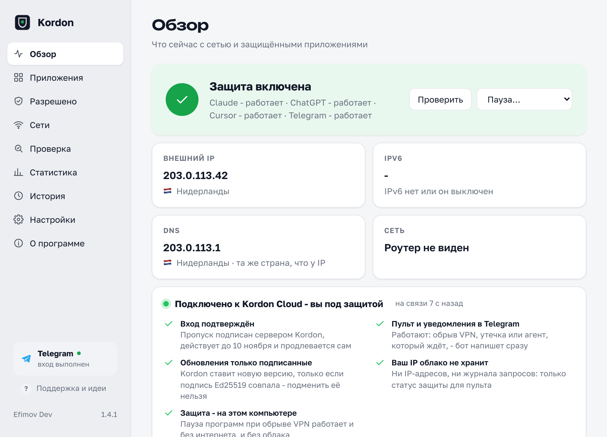

<p align="center"></p>

<h3 align="center">A kill switch for apps. Your VPN drops, your IP changes or the internet goes away - Kordon freezes the apps you chose within a fraction of a second. The right IP is back - they carry on as if nothing happened.</h3>

<p align="center">
  <a href="https://github.com/ef1m03/kordon/releases/latest"></a>
  
  <a href="LICENSE"></a>
  · <a href="README.md">Русский</a>
</p>

<table>
  <tr>
    <td width="33%"><p align="center"><b>All good</b><br><sub>country and IP, protected apps, one-click actions</sub></p></td>
    <td width="33%"><p align="center"><b>The VPN dropped</b><br><sub>apps paused, a ring counts down to closing</sub></p></td>
    <td width="33%"><p align="center"><b>A new version</b><br><sub>what's new and an Update button</sub></p></td>
  </tr>
</table>

<p align="center">
  <picture>
    <source media="(prefers-color-scheme: dark)" srcset="docs/img/panel-overview-dark.png">
    
  </picture>
</p>
<p align="center"><sub>The tray window (screenshots in Russian; the app follows the system language) and the full panel.</sub></p>

## Why Kordon

| | VPN client kill switch | Firewall rules | **Kordon** |
|---|:---:|:---:|:---:|
| Only touches the apps you chose | ❌ cuts everything | ✅ | ✅ |
| A 2-second VPN blip doesn't lose your work | ❌ | ❌ drops connections | ✅ freezes |
| Allow a whole country, not one address | ❌ | ❌ | ✅ |
| IP and country visible at a glance | ❌ | ❌ | ✅ |
| Works with proxy-mode VPN clients | depends | ❌ | ✅ |
| Catches IPv6 leaks when the VPN tunnels only IPv4 | not always | ❌ | ✅ |
| Catches DNS leaks | not always | ❌ | ✅ |
| Per-app rules | ❌ | by hand | ✅ |
| No VPN needed at home, required in a café | ❌ | ❌ | ✅ trusted networks |
| No admin rights needed | not always | ❌ | ✅ |
| Same tool on macOS, Windows and Linux | ❌ | ❌ | ✅ |

## What it does

- **The tray window**: click the icon and see what matters: protection, country, IP, which apps are protected. Pause, check the IP, allow the country or trust this network in one click. It opens instantly and follows the system's light or dark look.
- **The Kordon panel**: a real window with status, apps, rules, networks, statistics, history and every setting. No file editing.
- **Per-app rules**: Claude only from the Netherlands, Cursor from the EU and US. Groups work independently.
- **Trusted networks**: work without a VPN at home or the office, protected everywhere else. Recognised by the router, no location permission needed.
- **DNS leaks**: warns (or freezes) when lookups bypass the VPN.
- **Statistics** for the last two weeks, and **Report a problem** with the log pre-filled and every IP/MAC masked.

- **Freezes instead of killing.** The network changes, the protected apps are paused (`SIGSTOP` / `NtSuspendProcess`). Same IP - you won't notice. An allowed IP is back within 20 s - the app continues where it was.
- **Closes them if the IP doesn't come back**: politely first so they can save, then by force. While the IP isn't allowed they can't be started again.
- **Allow IPs, subnets or whole countries** - VPNs rotate addresses within a country all the time.
- **Your IP and country always in sight**: flag and IP in the macOS menu bar, a country-code badge in the Windows tray, coloured by state.
- **Presets**: Claude, ChatGPT, Codex, Cursor, Windsurf, GitHub Copilot, Gemini CLI, Perplexity, Telegram, Discord, Slack, Zoom; browsers for AI on the web: Google Chrome, Yandex Browser, Microsoft Edge, Brave, Firefox (a browser freezes whole, with every tab, so keep a separate one for AI); plus any app of your own.
- **IPv6 leaks**: many VPNs tunnel only IPv4; Kordon checks both addresses.
- **Whole process trees**: everything the app started (MCP servers, `curl`, `git` under Claude Code) is frozen too.
- **Two independent services must agree** on the IP; any disagreement counts as a possible leak.
- **Instant reaction** to OS network events, and a supervisor that restarts Kordon if it ever crashes.
- **Proxy-mode VPN clients** (v2rayN, Hiddify, Clash) are handled: the IP is checked through the system proxy, the way your apps see it.
- **One-click updates**: a new release shows up in the tray window with what's new and an "Update" button; Kordon downloads it (with progress), checks its SHA-256 and restarts, then shows once what changed. Nothing is installed without your click.
- Pause, event history, a screen-sharing mode that hides the IP, hot-reloaded `config.yaml`.
- **First start in two clicks**: the window asks whether the address is the VPN's and offers to protect AI apps that are already running.
- **Browser extension**: pauses only Claude, ChatGPT, Gemini and other AI tabs, the rest of the browser keeps working; checks WebRTC leaks too. Needs Kordon 1.3+; install `kordon-extension.zip` from the latest release (unpacked, developer mode) until it's in the Chrome Web Store.
- **Telegram alerts** through the Kordon bot: the VPN dropped, apps paused, apps resumed. No addresses in the messages.
- **Leak check** in the panel: every IP service on its own, IPv6, DNS country, and the address of programs that ignore the system proxy.
- No admin rights, nothing sent without your consent (the user count is opt-in), free. Every build is scanned by VirusTotal and Kaspersky before release; results are in the release notes.

## Install

macOS / Linux:

```bash
curl -fsSL https://raw.githubusercontent.com/ef1m03/kordon/main/scripts/install.sh | sh
```

Windows (PowerShell):

```powershell
irm https://raw.githubusercontent.com/ef1m03/kordon/main/scripts/install.ps1 | iex
```

Homebrew: `brew install --cask ef1m03/tap/kordon` · winget (under Microsoft's review): `winget install EfimovDev.Kordon`.

Or grab the files from the [latest release](https://github.com/ef1m03/kordon/releases/latest). The builds aren't notarized/signed (that's paid), so the first manual launch needs *right click → Open* on macOS (*System Settings → Privacy & Security → Open Anyway* on macOS 15+) or *More info → Run anyway* on Windows. The install scripts avoid that.

On first start Kordon **allows the current IP**, so install it with your VPN on. Claude is protected by default; pick other apps in the *Protected apps* menu.

## Settings

`config.yaml` lives in `~/Library/Application Support/Kordon/` (macOS), `%APPDATA%\Kordon\` (Windows) or `~/.config/kordon/` (Linux). It is commented and reloaded on save.

```yaml
apps: ["claude", "cursor"]
custom_apps:
  - name: "My client"
    match: ["/MyClient.app/", "myclient.exe", "args:my-tool/cli.js"]
allow:
  ips: ["64.137.54.87", "185.12.40.0/24"]
  countries: ["NL", "DE"]
grace: 20s
close_timeout: 5s
check_interval: 5s
min_agree: 2
check_ipv6: true
menubar: ip   # ip, country or icon
```

CLI: `kordon panel`, `kordon status`, `kordon allow [IP|subnet|CC]`, `kordon config`, `kordon autostart on|off`, `kordon update`, `kordon headless`.

## What goes over the network

Requests: the public IP (`api.ipify.org`, `ipv4.icanhazip.com`, `v4.ident.me`, `checkip.amazonaws.com`, `ipinfo.io/ip`; IPv6: `api6.ipify.org`, `ipv6.icanhazip.com`, `v6.ident.me`; all configurable) and its country (`ipinfo.io`, falling back to `ipapi.co` and `api.country.is`, cached). Opt-in only: a daily `{"v", "os"}` ping for the user count and Telegram alert texts (without addresses) to `efimovdev.ru/kordon/api`. Plus, every 6 hours, one request to `api.github.com` for the latest version number (`update_check: false` turns it off). No analytics.

## How safe is it

Covered: IPv6 leaks, child processes, a single lying IP service, missed network changes, Kordon crashing, tampered downloads (installers check SHA-256; every release file is scanned by VirusTotal and Kaspersky, with the results in the release notes).

Not covered, honestly: Kordon works at the app level, not the network level - there are milliseconds between a network change and the freeze, so use your VPN's own kill switch too if you need "not a single packet". Admin processes and services aren't touched. Malware on the same machine can just stop Kordon. PAC proxy scripts aren't supported. On Windows, npm-installed Claude Code started from a terminal runs as `node.exe` - use the native installer.

---

<p align="center">© <a href="https://efimovdev.ru/kordon/?utm_source=kordon&utm_medium=github"><b>Efimov Dev</b></a> - <a href="https://efimovdev.ru/kordon/?utm_source=kordon&utm_medium=github">efimovdev.ru</a>. Questions and ideas: Telegram <a href="https://t.me/efimov_dev">@efimov_dev</a>.<br>
Kordon is free, closed-source software (<a href="LICENSE">license</a>; versions 1.0.0-1.2.1 were MIT, 1.2.2 GPL-3.0). The name and logo belong to Efimov Dev; official builds only from <a href="https://github.com/ef1m03/kordon/releases">Releases</a>.</p>
