<p align="center">
  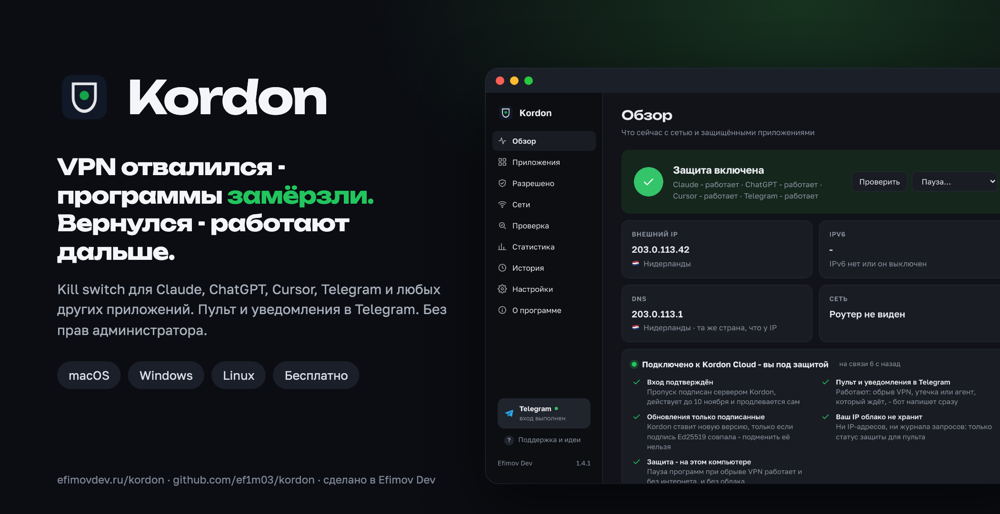
</p>

<h3 align="center">Kill switch для приложений. Отвалился VPN, сменился IP или пропал интернет - Kordon за долю секунды замораживает Claude, ChatGPT, Cursor и другие программы. Вернулся правильный IP - они продолжают работу как ни в чём не бывало. А пульт - у вас в Telegram.</h3>

<p align="center"><b>Сайт Kordon: <a href="https://kordon.tech/">kordon.tech</a></b> - скачать, как работает, ответы на вопросы</p>

<p align="center">
  <a href="https://github.com/ef1m03/kordon/releases/latest"></a>
  
  <a href="LICENSE"></a>
  <a href="#официальные-сборки-и-проверки"></a>
  <a href="#официальные-сборки-и-проверки"></a>
</p>

<p align="center">
  <a href="#почему-kordon">Почему Kordon</a> ·
  <a href="#установка">Установка</a> ·
  <a href="#как-это-работает">Как работает</a> ·
  <a href="#настройки">Настройки</a> ·
  <a href="#что-kordon-отправляет-в-сеть">Приватность</a> ·
  <a href="README.en.md">English</a>
</p>

<table>
  <tr>
    <td width="33%">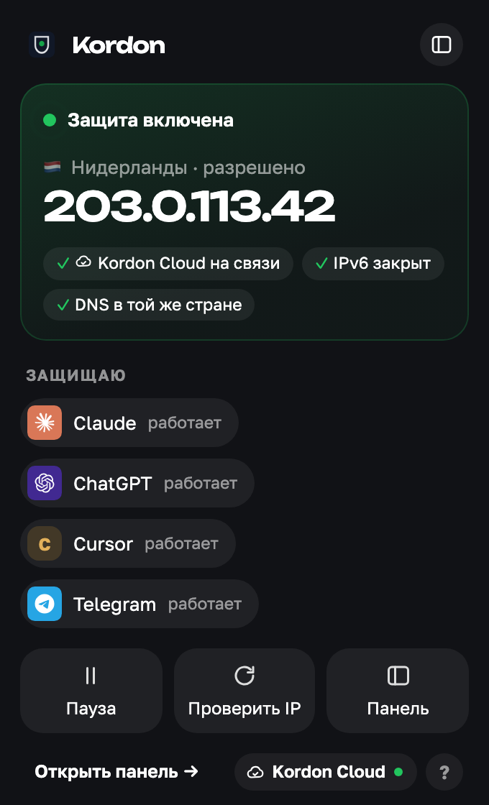<p align="center"><b>Всё в порядке</b><br><sub>страна и IP крупно, что защищается, действия в один клик</sub></p></td>
    <td width="33%">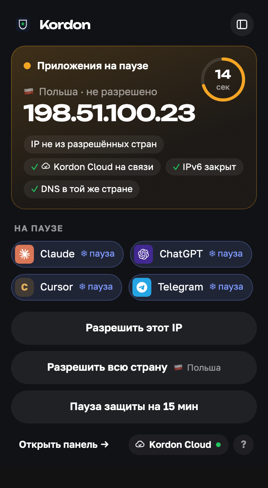<p align="center"><b>VPN отвалился</b><br><sub>приложения на паузе, кольцо считает секунды до закрытия</sub></p></td>
    <td width="33%">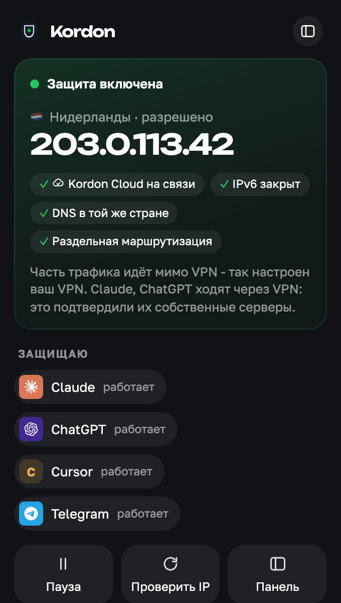<p align="center"><b>Раздельная маршрутизация</b><br><sub>часть сайтов мимо VPN, а Claude и ChatGPT - через него: это подтвердили их серверы</sub></p></td>
  </tr>
</table>

<p align="center"><sub>Клик по значку Kordon в строке меню (Mac) или у часов (Windows) открывает это окно.</sub></p>

## Зачем

Некоторые программы нельзя запускать «не с того» адреса: рабочий софт, который должен ходить только через корпоративный VPN, ИИ-ассистенты, мессенджеры, торрент-клиенты. VPN рвётся постоянно: после сна, при смене Wi-Fi, на переподключении. Программа в этот момент уже шлёт запросы с вашего настоящего IP, а вы узнаёте об этом последним.

Обычный kill switch внутри VPN-клиента рубит интернет целиком. Kordon работает точечно: трогает только те приложения, которые вы выбрали, а остальное оставляет как есть.

## Почему Kordon

| | Kill switch в VPN-клиенте | Правила фаервола | **Kordon** |
|---|:---:|:---:|:---:|
| Трогает только выбранные программы, остальной интернет работает | ❌ рубит всё | ✅ | ✅ |
| VPN моргнул на 2 секунды - программа продолжает с того же места | ❌ | ❌ обрывает соединения | ✅ заморозка |
| Разрешить целую страну, а не один адрес | ❌ | ❌ | ✅ |
| Видно IP и страну, не открывая ничего | ❌ | ❌ | ✅ |
| Работает с VPN в режиме прокси (v2rayN, Hiddify, Clash) | зависит от клиента | ❌ | ✅ |
| Ловит утечку через IPv6, когда VPN заворачивает только IPv4 | не всегда | ❌ | ✅ |
| Ловит утечку DNS | не всегда | ❌ | ✅ |
| Свои правила для каждого приложения | ❌ | вручную | ✅ |
| Дома можно без VPN, в кафе - только с ним | ❌ | ❌ | ✅ доверенные сети |
| Нормальное окно с настройками и статистикой | зависит | ❌ | ✅ |
| Работает без прав администратора | не всегда | ❌ | ✅ |
| Один и тот же инструмент на Mac, Windows и Linux | ❌ | ❌ у каждой системы свой | ✅ |
| Видит, если VPN тихо пускает ИИ-сервис мимо туннеля | ❌ | ❌ | ✅ спрашивает сам сервис |
| Пульт и уведомления с телефона | ❌ | ❌ | ✅ в Telegram |
| Бесплатно | зависит | ✅ | ✅ |
| Каждая сборка проверена антивирусами, результаты открыты | ❌ | - | ✅ |

Коротко, чем он хорош:

- **Не ломает работу.** Главная боль обычных kill switch'ей - они рубят всё и сразу, и после каждого моргания VPN приходится переоткрывать программы и терять несохранённое. Kordon ставит программу на паузу и отпускает, как только видит правильный IP. В большинстве случаев вы даже не заметите, что что-то произошло.
- **Ставится одной строкой и дальше не требует внимания.** Не нужно разбираться в фаерволе и маршрутах: при первом запуске текущий IP становится разрешённым, Claude уже под защитой, остальное - переключателями в панели.
- **Честно показывает, что происходит.** Цвет значка, обратный отсчёт до закрытия, история событий, уведомления с понятными словами: «IP 91.64.1.1 (Германия) не разрешён, закрою через 20 с».
- **Ничего не прячет.** Ничего не отправляет без вашего согласия, все сетевые запросы перечислены в разделе ниже, а каждая сборка проверяется VirusTotal и Kaspersky - результаты лежат в описании релиза. Перед каждым выпуском Kordon тестируется на трёх системах, включая настоящую заморозку живого процесса.
- **Перестраховывается там, где это важно.** IP подтверждают минимум два независимых сервиса, проверяется и IPv6, замораживается всё дерево процессов программы, а упавший Kordon поднимается сам. Подробно - в разделе [«Насколько это надёжно»](#насколько-это-надёжно).

## Возможности

- **Kordon Cloud - вы на связи.** После входа окно показывает «Kordon Cloud на связи», а в панели видно, что именно работает: вход подтверждён подписанным пропуском, пульт и уведомления в Telegram на связи, обновления ставятся только с подписью, IP-адресов облако не хранит. Сама защита - на вашем компьютере и работает даже без интернета и без облака.
- **Раздельная маршрутизация.** Если VPN пускает часть сайтов напрямую (roscomvpn-routing и подобные), сервисы проверки IP показывают разное. Kordon спрашивает серверы самих Claude, ChatGPT, Codex и Perplexity, с какого адреса к ним пришли, - раз в 15 секунд и сразу после смены сети. Сервер видит VPN - программа работает, видит домашний адрес - встаёт на паузу.
- **Свои сервисы проверки IP.** В панели («Проверка» → «Ответы сервисов») видно, что показывает каждый сервис, и галочкой выбираются те, что участвуют в проверке.
- **Уведомления без шума.** События паузы и продолжения в пределах полуминуты объединяются в одно тихое сообщение. Интервал относится к получению событий в Cloud, а не к доказанному обрыву VPN. Одна и та же утечка - не чаще раза в сутки. Настройка - `/notify` в боте.
- **Окно в трее.** Клик по значку - и сразу видно главное: защита, страна, IP, какие программы под защитой. Пауза, проверка IP, «разрешить страну» и «доверять этой сети» - с подтверждением последствий. Окно лёгкое, открывается мгновенно, в стиле системы: светлое или тёмное.
- **Первый запуск в два клика.** Окно само спросит, адрес ли это VPN, предложит защитить уже запущенные ИИ-программы и разрешить всю страну.
- **Расширение для браузера.** Работаете с ИИ в браузере - ставьте [расширение Kordon](#расширение-для-браузера): вкладки Claude, ChatGPT, Gemini и других ИИ встают на паузу, а остальной браузер работает. Оранжевый «!» на значке расширения - знак, что браузер выдаёт вас: часовой пояс не подходит к стране IP или WebRTC показывает сайтам ваш адрес.
- **Уведомления в Telegram.** Бот Kordon напишет, когда VPN отвалился и программы встали на паузу, и когда всё вернулось. Удобно, когда Claude Code или другой агент работает без вас.
- **Проверка утечек.** Одна кнопка в панели: видят ли все сервисы один адрес, идёт ли IPv6 мимо VPN, через какую страну DNS и с какого адреса выходят программы, которые не смотрят на системный прокси (терминал, Claude Code, git). Плюс проверка WebRTC в расширении.
- **Панель Kordon** - отдельное окно со статусом, приложениями, правилами, сетями, статистикой, историей и всеми настройками. Без правки файлов.
- **Свои правила для каждого приложения.** Например, Claude только из Нидерландов, а Cursor из любой страны Евросоюза и США. Правила работают независимо: одно приложение может быть заморожено, пока другое продолжает работать.
- **Доверенные сети.** Дома или в офисе можно работать без VPN, а в кафе и на чужом Wi-Fi Kordon снова следит. Сеть узнаётся по её роутеру, никаких разрешений на геолокацию не нужно.
- **Утечка DNS.** VPN заворачивает трафик, а запросы к сайтам уходят провайдеру - Kordon это видит и предупреждает (или замораживает, как настроите).
- **Профили правил.** «Работа: только Нидерланды», «Личное: любая страна ЕС» - разные наборы стран и адресов, переключаются в один клик в окне у часов, в панели и с телефона в пульте.
- **Скорость до ИИ.** Kordon замеряет, за сколько Claude, ChatGPT, Cursor и Gemini отвечают через текущий маршрут, и предупреждает, если сейчас заметно медленнее обычного.
- **Утечки - в Telegram.** После смены сети и раз в 6 часов Kordon сам гоняет проверку утечек и пишет в бота о новой проблеме, а потом - что она закрыта.
- **Статистика и здоровье VPN**: сколько раз за неделю падал VPN и сколько неделей раньше, сколько в среднем длилась пауза, вернулся ли он вовремя и в какие часы падает чаще всего. То же коротко в еженедельном отчёте бота.

- **Заморозка вместо убийства.** Сменилась сеть - приложения ставятся на паузу за долю секунды. Если IP прежний, это незаметно. Если нужный IP вернулся в течение 20 секунд, приложение продолжает с того же места, ничего не теряется.
- **Закрытие, если IP так и не вернулся.** Сначала вежливо (приложение успевает сохраниться), через 5 секунд принудительно. Пока IP не разрешён, приложение не даст запустить заново.
- **Разрешённые IP, подсети и страны.** VPN часто меняет адрес внутри страны - разрешите всю страну, и не придётся подтверждать каждый новый адрес.
- **IP и страна всегда на виду.** На Mac - флаг и IP прямо в строке меню, на Windows - значок с кодом страны у часов. Цвет показывает состояние: зелёный, оранжевый, красный.
- **Не только ИИ.** Программы разложены по задачам: ИИ (Claude, ChatGPT, Codex, Cursor, Windsurf, Visual Studio Code, GitHub Copilot, Gemini CLI, Perplexity), работа (Figma, Notion, Slack, Zoom), фриланс (Upwork), криптобиржи и трейдинг (Binance, TradingView), музыка и видео (Spotify), общение (Telegram, Discord). Кнопка «Защищать все» включает группу целиком, вместе с её сайтами в расширении: Upwork и Fiverr, Binance, Bybit и OKX, Figma, Notion, Miro и Canva, Netflix и Spotify. Браузеры: Google Chrome, Яндекс Браузер, Microsoft Edge, Brave, Firefox. Плюс любое своё приложение.
- **Часовой пояс.** Сайты видят пояс браузера: московское время при немецком IP выдаёт VPN, и биржи могут заблокировать аккаунт. Kordon сравнивает пояс компьютера со страной IP и предупреждает, а расширение показывает, что видят сайты.
- **Ловит утечку через IPv6.** Многие VPN заворачивают только IPv4, а по IPv6 программы продолжают ходить напрямую. Kordon проверяет оба адреса.
- **Вся программа целиком.** Замораживается не только сама программа, но и всё, что она запустила: у Claude Code это MCP-серверы, `curl`, `git`, терминальные команды.
- **Видит VPN в режиме прокси.** v2rayN, Hiddify, Clash и похожие клиенты работают как системный прокси, и Kordon проверяет IP через него - то есть видит тот же адрес, что и ваши программы. Выключился такой клиент - Kordon ставит программы на паузу сразу, а не при следующей проверке.
- **Обновления в один клик.** Вышла новая версия - в окне Kordon появится карточка: что в ней нового и кнопка «Обновить». Kordon скачает её (видно прогресс), сверит контрольную сумму и перезапустится, настройки останутся. После обновления покажет, что изменилось. По умолчанию установка ручная. В готовящейся сборке на Mac и Linux можно отдельно включить автообновление на выбранный час, когда защищаемые программы и браузеры закрыты. [Условия и ограничения](docs/automatic-updates.md).
- **Пауза** на 15 минут, час или до перезапуска.
- **История событий** в панели, журнал в файле.
- **«Сообщить о проблеме»** открывает заявку на GitHub с уже подставленной версией, системой и концом журнала. Все IP и MAC-адреса в нём заранее скрыты.
- **Режим для созвонов:** рядом со значком можно показывать только страну или ничего, чтобы IP не светился при показе экрана.
- **Без прав администратора**, без слежки, бесплатно.

## Как это работает

<p align="center">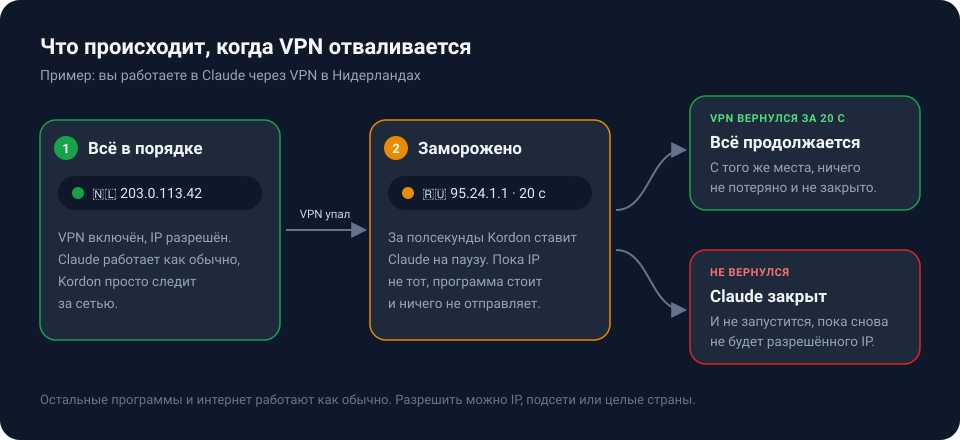</p>

Kordon подписан на системные события сети: как только появляется или исчезает VPN-туннель, меняется Wi-Fi, адрес или маршрут, система сама сообщает ему об этом. Выбранные приложения сразу замораживаются, и тут же проверяется внешний IP. Если всё в порядке, они размораживаются, обычно меньше чем через секунду. Внешний IP сверяется и сам по себе, раз в 5 секунд: так Kordon замечает, когда VPN переключился на другой сервер, не меняя ни адаптеров, ни маршрутов.

Заморозка - это штатная пауза процесса в системе (`SIGSTOP` на Mac и Linux, `NtSuspendProcess` на Windows). Замороженная программа не выполняет ни одной инструкции и ничего не отправляет. Окно на это время перестаёт отвечать, это нормально.

## Установка

### macOS

Откройте Терминал и вставьте:

```bash
curl -fsSL https://raw.githubusercontent.com/ef1m03/kordon/main/scripts/install.sh | sh
```

Скрипт скачает свежую версию в «Программы», запустит её и включит автозапуск. Справа вверху, рядом с часами, появится зелёная точка с флагом и IP.

Или через [Homebrew](https://brew.sh):

```bash
brew install --cask ef1m03/tap/kordon
```

<details>
<summary>Установить вручную, без Терминала</summary>

1. Скачайте `Kordon-macos.zip` со страницы [последнего релиза](https://github.com/ef1m03/kordon/releases/latest) и распакуйте.
2. Перетащите `Kordon.app` в «Программы».
3. Откройте. Kordon подписан сертификатом Apple Developer ID, а проверку Apple (нотаризацию) пройдёт в следующей версии. Поэтому при первом запуске macOS может сказать, что не может проверить программу: нажмите «Готово», откройте Системные настройки → Конфиденциальность и безопасность и нажмите «Всё равно открыть». Строка установки из Терминала этого окна не показывает.
</details>

Поддерживаются macOS 11 и новее, Apple Silicon и Intel.

### Windows

**Шаг 1 - установка.** Откройте PowerShell (Пуск → наберите «PowerShell») и вставьте команду из блока ниже. Ссылка `t.me/kordon_security_bot` не является командой PowerShell: её открывают в Telegram уже после установки.

Команда установки:

```powershell
irm https://raw.githubusercontent.com/ef1m03/kordon/main/scripts/install.ps1 | iex
```

Kordon установится в вашу папку пользователя (права администратора не нужны), появится в меню Пуск и запустится. Значок с кодом страны появится у часов.

Или через winget (каталог Microsoft; пакет проходит их проверку):

```powershell
winget install EfimovDev.Kordon
```

<p align="center"></p>

> Если значка не видно, он спрятался под стрелкой **^** у часов. Перетащите его оттуда на панель задач, чтобы страна была видна всегда.

<details>
<summary>Установить вручную</summary>

1. Скачайте `kordon-windows-amd64.exe` со страницы [последнего релиза](https://github.com/ef1m03/kordon/releases/latest) (для Windows на ARM - `arm64`).
2. Положите его куда удобно, например в `C:\Users\<вы>\Programs\Kordon\`, и запустите.
3. Если появится синее окно «Windows защитила ваш компьютер»: **Подробнее → Выполнить в любом случае.** Файл не подписан сертификатом (он платный), Windows предупреждает о любых таких программах.
</details>

Поддерживаются Windows 10 и 11, x64 и ARM.

### Linux

```bash
curl -fsSL https://raw.githubusercontent.com/ef1m03/kordon/main/scripts/install.sh | sh
```

Значок работает в KDE, XFCE, Cinnamon и других средах с системным треем. В GNOME нужно расширение [AppIndicator](https://extensions.gnome.org/extension/615/appindicator-support/). Без трея можно запустить `kordon headless` - тогда события пишутся в консоль и приходят уведомлениями.

## Панель Kordon

Открывается из окна Kordon (**«Открыть панель →»**) или правым кликом по значку. На Mac это обычное окно приложения, на Windows - отдельное окно Edge без адресной строки (Edge есть в каждой Windows), на Linux - вкладка браузера.

<table>
  <tr>
    <td width="50%">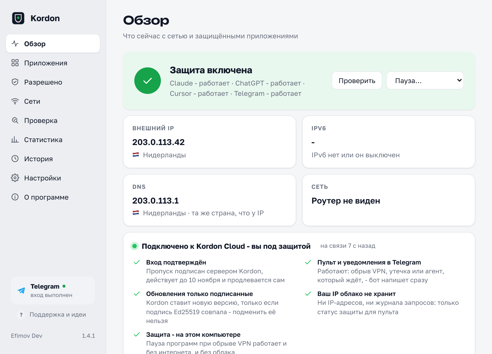<p align="center"><b>Обзор</b><br><sub>IP, IPv6, DNS, сеть и что запущено</sub></p></td>
    <td width="50%">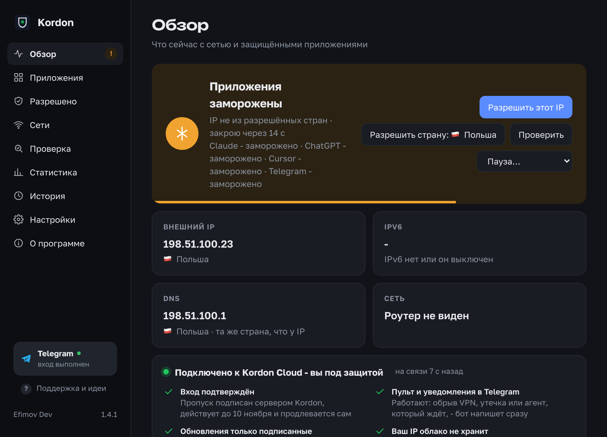<p align="center"><b>VPN отвалился</b><br><sub>приложения заморожены, идёт отсчёт, разрешить IP - после проверки и подтверждения</sub></p></td>
  </tr>
  <tr>
    <td width="50%">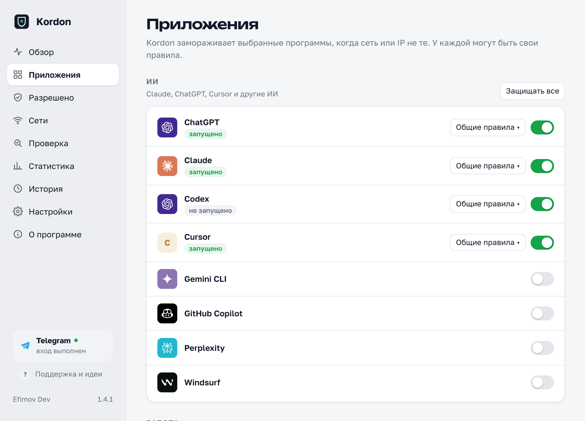<p align="center"><b>Приложения</b><br><sub>готовые наборы, браузеры для ИИ, свои правила: Cursor можно в NL, DE и US</sub></p></td>
    <td width="50%">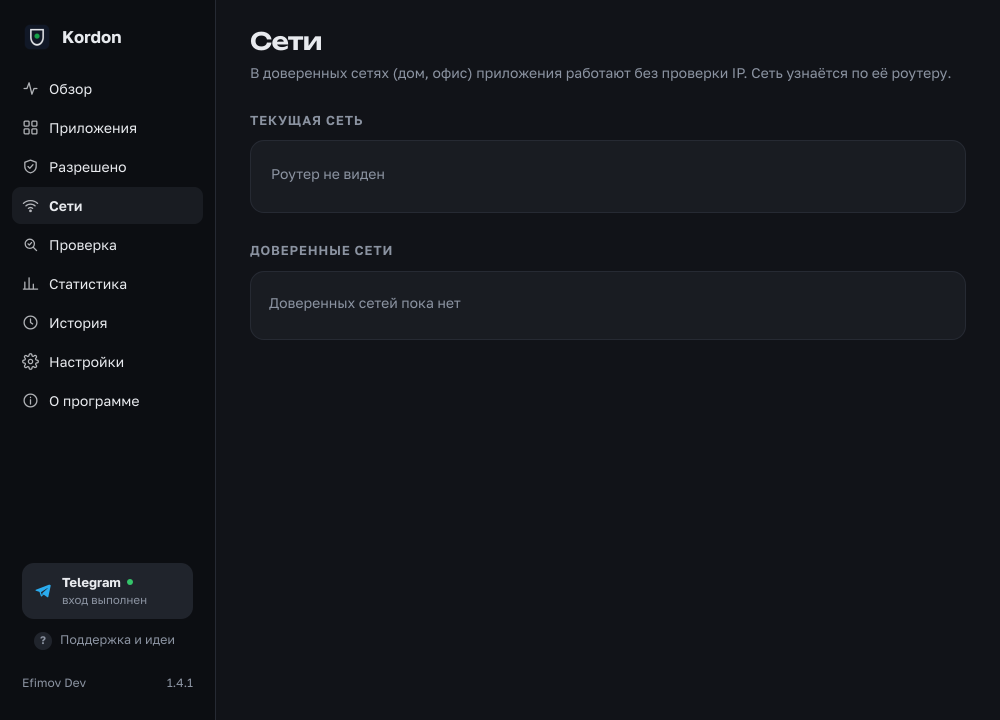<p align="center"><b>Сети</b><br><sub>дома и в офисе - без VPN, в остальных сетях защита</sub></p></td>
  </tr>
  <tr>
    <td width="50%">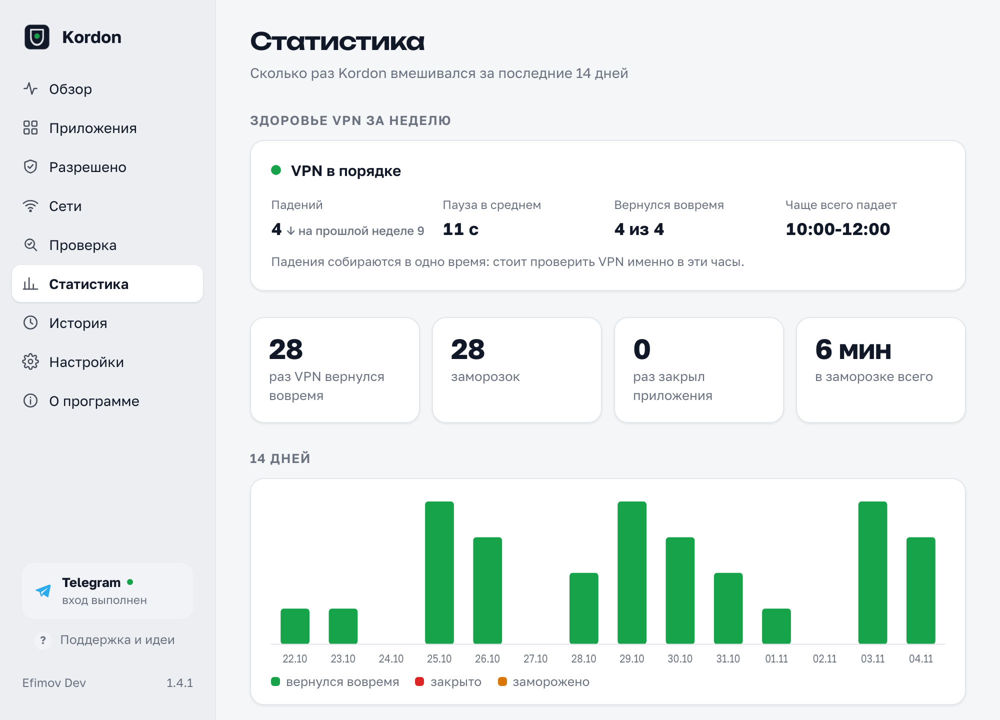<p align="center"><b>Статистика</b><br><sub>сколько раз VPN вернулся вовремя и сколько раз Kordon закрыл приложения</sub></p></td>
    <td width="50%">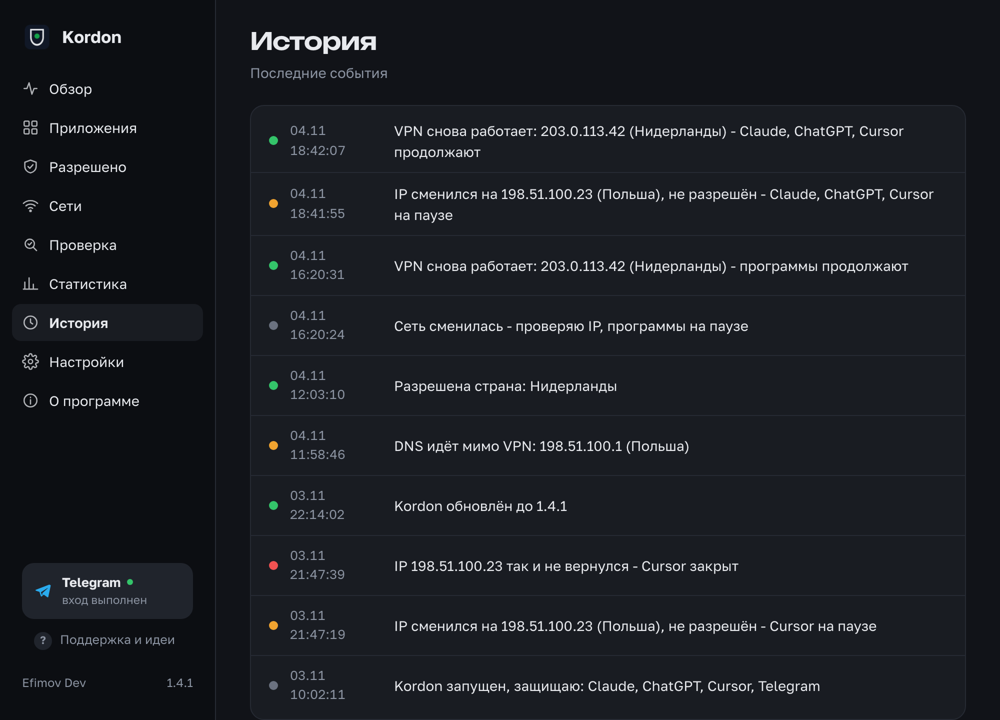<p align="center"><b>История</b><br><sub>смены сети и IP, заморозки, закрытия</sub></p></td>
  </tr>
  <tr>
    <td width="50%">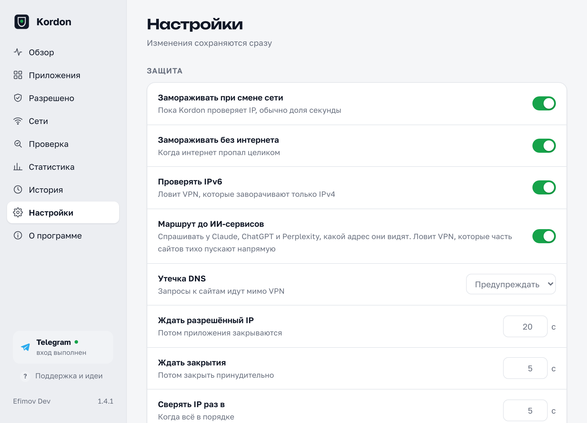<p align="center"><b>Настройки</b><br><sub>всё из config.yaml - переключателями</sub></p></td>
    <td width="50%">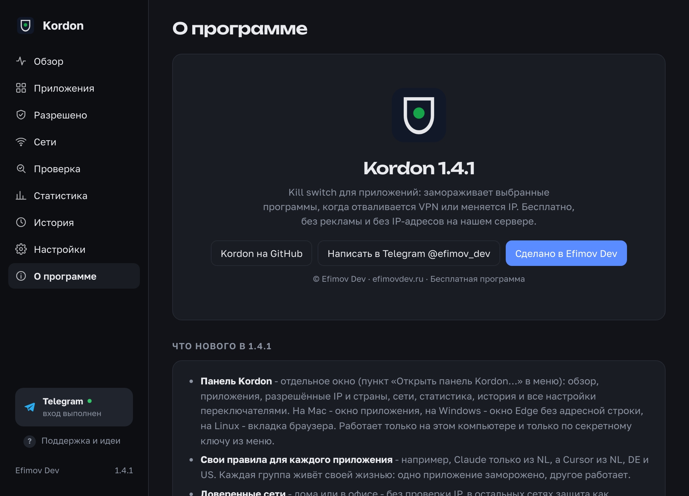<p align="center"><b>Что нового</b><br><sub>изменения текущей версии - прямо в программе</sub></p></td>
  </tr>
</table>

<sub>На скриншотах демонстрационные данные. Адрес роутера скрыт.</sub>

- **Обзор** - статус, внешний IP, IPv6, DNS, текущая сеть и кнопки «Разрешить этот IP», «Пауза», «Проверить».
- **Приложения** - переключатели для готовых наборов и браузеров, свои приложения и свои правила для каждого.
- **Разрешено** - IP, подсети и страны, общие для всех приложений без своих правил.
- **Сети** - доверенные сети: «Доверять этой сети», переименовать, удалить.
- **Проверка** - глубокая проверка на утечки с понятными советами, что включить в VPN.
- **Статистика** и **История** - что происходило.
- **Настройки** - всё из `config.yaml`, переключателями: Telegram, автозапуск, что показывать рядом со значком, уведомления. Там же журнал и «Сообщить о проблеме».
- **О программе** - версия, что в ней нового, ссылки.

Панель - это страница, которую отдаёт сам Kordon только на `127.0.0.1`. Открыть её можно только из меню: каждый запуск Kordon придумывает новый секретный ключ, без него сервер не отвечает. Так до настроек не дотянется ни сайт в браузере, ни другой пользователь компьютера.

## Расширение для браузера

Приложение Kordon замораживает программы целиком, и браузер тоже - со всеми вкладками. Если ИИ у вас в браузере, удобнее расширение: оно ставит на паузу только ИИ-сайты.

- **Что делает.** Пока Kordon говорит, что IP не тот, у вкладок claude.ai, chatgpt.com, gemini.google.com, perplexity.ai и других ИИ рвутся открытые соединения (в том числе ответ, который как раз печатается), новые запросы не уходят, а сверху - заглушка «Вкладка на паузе». Новая страница ИИ-сайта открывается как «Сайт на паузе». Вернулся правильный IP - вкладки продолжают сами, ничего перезагружать не нужно.
- **Какие сайты** - список в окне расширения: любой можно выключить или добавить свой.
- **WebRTC.** Кнопка «Проверить» показывает, какой адрес браузер выдаёт сайтам через WebRTC. Если он не совпадает с VPN - «Закрыть утечку» запрещает WebRTC ходить в обход прокси и VPN.
- **Нужно приложение Kordon 1.3 или новее.** Расширение спрашивает у него статус на `127.0.0.1` и никуда больше не обращается. Без запущенного Kordon вкладки не защищены - значок расширения становится серым.
- **Браузеры:** Chrome, Яндекс Браузер, Edge, Brave и другие на Chromium. Firefox - позже.

Пока расширения нет в Chrome Web Store, его можно поставить вручную: скачайте `kordon-extension.zip` из [последнего релиза](https://github.com/ef1m03/kordon/releases/latest), распакуйте, откройте `chrome://extensions`, включите «Режим разработчика» и нажмите «Загрузить распакованное».

## Telegram: вход, пульт и уведомления

Kordon бесплатный, и единственное, о чём мы просим, - один раз войти через бота [@kordon_security_bot](https://t.me/kordon_security_bot): кнопка «Войти через Telegram» в окне Kordon, потом «Старт» в боте. Telegram только на телефоне - в окне есть QR-код. Кто пользовался Kordon до версии 1.4.0, может войти до 6 ноября, 12:00 по Москве. **Защита работает и без входа**: программы под защитой встают на паузу как обычно, просто окно и панель ждут входа. На сервере без окна вход делает команда `kordon login`.

Что даёт вход:

- **События агентов.** После подключения в настройках Claude Code сообщает о запросе ввода и завершении ответа, Codex CLI - о завершении ответа. Только когда вы отошли. Низкая загрузка CPU сама по себе больше не вызывает уведомления. [Подключение и ограничения](docs/agents/notifications.md).
- **Уведомления о проверках** с кнопками: пауза на час и подтверждение добавления страны. Точный IP разрешается локально на компьютере, адрес не отправляется в Cloud. Короткая пауза и продолжение объединяются в одно тихое сообщение без утверждения о причине. Уведомления настраиваются командой `/notify`.
- **Пульт** - мини-приложение в боте: статус компьютера, страна, программы, агенты, итоги проверок и скорость до ИИ. Есть пауза и подтверждение страны. Пока тестируем нагрузку Cloud, один Telegram - один активный компьютер.
- **Недельный отчёт:** сколько раз подводил VPN и сколько раз Kordon успел.
- **Настройки переезжают:** на новом компьютере после входа Kordon предложит взять программы, страны и правила с другого. IP-адреса и домашние сети не переносятся.
- **Новости о версиях** и быстрые сообщения о важных исправлениях.

<p align="center">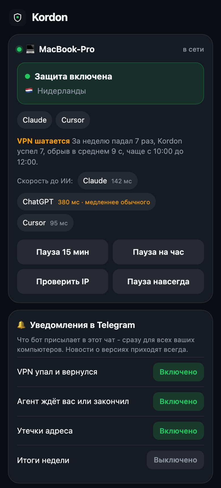</p>

Пока тестируем нагрузку Kordon Cloud, один Telegram - один компьютер. Вход с другого компьютера требует подтверждения замены: прежний выйдет из аккаунта. Переустановка того же компьютера не мешает, а если войти с другого, бот предложит заменить прежний одной кнопкой. Убрать старый компьютер можно и в пульте.

Вход подтверждает сервер Kordon подписанным пропуском на неделю, поэтому без интернета Kordon работает дальше, а обойти вход правкой файлов нельзя. Выйти - `/stop` в боте. Что при этом уходит на сервер - ниже.

## Первый запуск

1. При первом запуске Kordon **запоминает текущий IP как разрешённый** и сразу открывает окно: «Это адрес VPN?». Нажмите «Нет», если VPN был выключен, - Kordon забудет этот адрес, включите VPN и разрешите его адрес. Там же можно сразу защитить уже запущенные ИИ-программы.
2. По умолчанию защищается **Claude**. Другие приложения и браузеры включаются в панели на странице **«Приложения»**.
3. Если VPN выдаёт разные адреса в одной стране, нажмите в окне Kordon **«Разрешить всю страну»**.
4. Автозапуск включается сам. Выключить можно в панели, в **«Настройках»**.

## Окно в трее

Клик по значку Kordon открывает небольшое окно. Оно создаётся заранее и висит скрытым, поэтому открывается мгновенно и не тормозит. Закрывается само, как только вы кликнули в другое место, или по Escape.

<table>
  <tr>
    <td width="33%">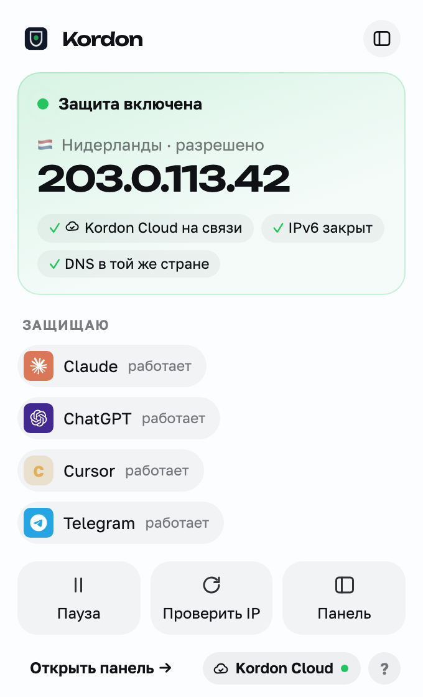<p align="center"><b>macOS</b><br><sub>под значком в строке меню, светлое или тёмное - как система</sub></p></td>
    <td width="33%">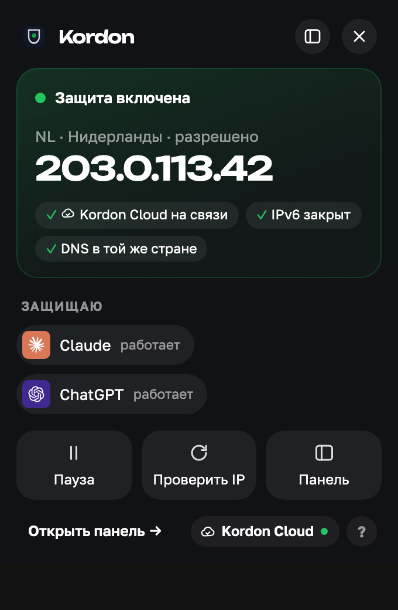<p align="center"><b>Windows</b><br><sub>над часами, на Windows 10 и 11</sub></p></td>
    <td width="33%">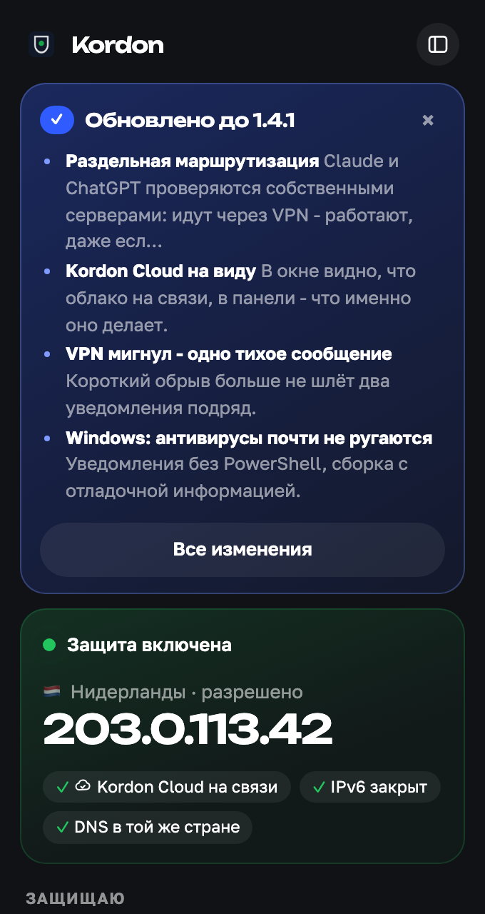<p align="center"><b>После обновления</b><br><sub>один раз показывает, что изменилось</sub></p></td>
  </tr>
</table>

| Что в окне | Зачем |
|---|---|
| 🟢 Защита включена | Состояние. 🟠 - приложения на паузе и идёт обратный отсчёт, 🔴 - закрыты, серый - пауза защиты |
| Страна и IP крупно | Текущий внешний адрес и разрешён ли он. Ниже - IPv6, DNS и доверенная сеть |
| Защищаю | Какие из защищаемых программ сейчас запущены и что с каждой: работает или на паузе |
| Пауза · Проверить IP · Эта сеть доверенная | Частые действия в один клик. Пауза - на 15 минут, час или до перезапуска |
| Разрешить этот IP / всю страну | Появляются, когда текущий адрес не разрешён. Одно нажатие - и приложения размораживаются |
| Карточка обновления | Вышла новая версия: что в ней нового и кнопка «Обновить» |
| Открыть панель → | Все настройки, статистика и история |

**Правый клик** по значку открывает короткое меню: окно Kordon, панель, проверка IP, пауза и выход. Остальное (настройки, журнал, история, автозапуск, «Сообщить о проблеме») - в панели.

На Linux окна нет: у разных сред рабочего стола слишком разные системные лотки, поэтому там остаётся полное меню со статусом и всеми действиями.

На Mac рядом со значком видно флаг и IP, на Windows значок сам показывает код страны. Что показывать рядом со значком - страну и IP, только страну или ничего - выбирается в настройках панели.

## Настройки

Всё хранится в одном файле с комментариями. Сохраните его - Kordon подхватит изменения сам, перезапуск не нужен. Если в файле ошибка, придёт уведомление, а Kordon продолжит работать со старыми настройками.

| Система | Где файл |
|---|---|
| macOS | `~/Library/Application Support/Kordon/config.yaml` |
| Windows | `%APPDATA%\Kordon\config.yaml` |
| Linux | `~/.config/kordon/config.yaml` |

```yaml
apps:
  - "claude"
  - "cursor"

custom_apps:
  - name: "Мой клиент"
    match: ["/MyClient.app/", "myclient.exe"]

allow:
  ips:
    - "203.0.113.42"
    - "185.12.40.0/24"
  countries:
    - "NL"
    - "DE"

freeze_on_network_change: true   # замораживать при любой смене сети, пока не проверим IP
block_when_offline: true         # пропал интернет - тоже замораживать
grace: 20s                       # сколько ждать разрешённый IP в заморозке
close_timeout: 5s                # сколько ждать вежливого закрытия
check_interval: 5s               # как часто сверять IP, когда всё хорошо
min_agree: 2                     # сколько сервисов должны назвать один и тот же IP
check_ipv6: true                 # проверять и IPv6
menubar: ip                      # ip, country или icon
update_check: true               # проверять новую версию (каждые 15 минут)
dns_check: warn                  # утечка DNS: warn, block или off

app_rules:                       # свои правила для отдельных приложений
  cursor:
    countries: ["NL", "DE", "US"]

trusted_networks:                # где можно без VPN (проще добавлять из панели)
  - name: "Дом"
    id: "a4:2b:b0:12:34:56"      # MAC роутера
```

### Своё приложение

В `match` можно писать:

- **имя файла** программы: `myapp` или `myapp.exe`;
- **часть пути** (со слешем): `/MyApp.app/` на Mac, `\MyApp\` на Windows;
- **часть командной строки** для скриптов на Node или Python: `args:my-tool/cli.js`.

Имя файла смотрите в «Мониторинге системы» на Mac или в «Диспетчере задач» на Windows (вкладка «Подробности»).

## Команды в терминале

```text
kordon status          IP, страна и состояние
kordon allow           разрешить текущий IP
kordon allow 1.2.3.4   разрешить IP или подсеть (1.2.3.0/24)
kordon allow NL        разрешить страну
kordon config          путь к файлу настроек
kordon autostart on    включить или выключить автозапуск
kordon panel           открыть панель
kordon update          поставить последнюю версию
kordon headless        работать без значка
kordon run -- команда  запустить команду под защитой Kordon
kordon version
```

### `kordon run` - kill switch для одной команды

Для сервера, VPS или CI, где нет окна: агент, скрипт, бот.

```bash
kordon run -- claude -p "почини тесты"
```

Команда работает по тем же правилам, что и Kordon (`allow`, `grace`, `close_timeout`, `block_when_offline` из `config.yaml`):

- **IP не тот** - команда и всё, что она запустила, встают на паузу.
- **Правильный IP вернулся** в течение `grace` - продолжают с того же места.
- **Не вернулся** - команда останавливается, `kordon run` выходит с кодом 75.
- **IP не тот уже при запуске** - команда не запускается, код 69.

Иначе код выхода - как у самой команды. Если сервер вошёл через Telegram (`kordon login`), о паузе и остановке пишет бот. Сначала разрешите VPN: `kordon allow` или `kordon allow NL`.

На Mac команда лежит внутри приложения: `/Applications/Kordon.app/Contents/MacOS/kordon`. На Windows - `%LOCALAPPDATA%\Programs\Kordon\kordon.exe`.

## Что Kordon отправляет в сеть

Вот все запросы Kordon, других нет:

1. **Узнать внешний IP:** первой - своя проверка Kordon `ip.kordon.tech` (называет адрес, с которого к ней пришли, и ничего не записывает: журнала нет), затем `api.ipify.org`, `ipv4.icanhazip.com`, `v4.ident.me`, `checkip.amazonaws.com`, `ipinfo.io/ip`. Спрашиваются все сразу, Kordon ждёт, пока двое назовут один и тот же адрес. Для IPv6 - `api6.ipify.org`, `ipv6.icanhazip.com`, `v6.ident.me`. Списки меняются в `ip_services` и `ipv6_services` - можно поставить свой сервер, который просто отдаёт IP текстом.
2. **Узнать страну по IP:** `ipinfo.io`, запасные - `ipapi.co` и `api.country.is`. Ответ запоминается, один и тот же адрес второй раз не спрашивается.

3. **Узнать, через какой DNS вы ходите:** запрос адреса `whoami.akamai.net` (Akamai отвечает адресом DNS-сервера, который его спросил: видно только ваш DNS - провайдера, VPN или публичный, - не ваш компьютер), если он не ответил - адрес в своей зоне Kordon `dns.kordon.tech` (наш сервер отвечает так же и ничего не записывает), и страна этого адреса. Раз в 10 минут или при смене сети; подробный TXT-запрос к `dns.kordon.tech` - только в ручной диагностике. Выключается `dns_check: off`.
4. **Проверить обновления:** каждые 15 минут один запрос к `kordon.tech/api/latest` - узнать номер последней версии. Это копия страницы последнего релиза с GitHub, запрос не несёт никаких данных, журнал адресов на сервере выключен. Если сервер не ответил - тот же вопрос к `api.github.com`. Ссылки на скачивание Kordon принимает только на свои релизы на GitHub. По умолчанию скачивание и установка запускаются по вашему клику, с проверкой контрольной суммы и подписи. В готовящейся сборке на Mac и Linux можно отдельно включить расписание автообновлений. Проверка отключается настройкой `update_check: false`, автоматическая установка отдельно - `auto_update: false`.

5. **Проверить маршрут до самих ИИ-сервисов:** раз в 2 минуты и после смены сети Kordon запрашивает `/cdn-cgi/trace` у `api.anthropic.com`, `claude.ai`, `chatgpt.com`, `api.openai.com` и `www.perplexity.ai` - только для защищённых программ. Сервис отвечает адресом и страной, с которых пришёл запрос, так видно, не пускает ли VPN этот домен мимо туннеля. Выключается `route_check: false`.
6. **Отдельного счётчика пользователей нет.** Раньше Kordon по согласию раз в день отправлял версию и систему; с входом через Telegram это не нужно, и новые версии ничего такого не шлют. Число установок сервер считает по тем, кто вошёл: по хешу секрета, с версией и системой, без IP - подробно в [SECURITY.md](SECURITY.md).
7. **Вход через Telegram.** Сервер хранит номер чата, хеш секрета из вашего `telegram.json` и имя компьютера. Пока вы вошли, Kordon раз в 15 секунд сообщает на `kordon.tech/api` для пульта: статус защиты, страну, названия программ под защитой, что делают агенты и итоги недели. IP-адресов там нет; сервер держит это только в памяти. Для переноса настроек сервер хранит последний профиль вашего чата: программы, разрешённые страны и переключатели, без адресов и сетей. Тексты уведомлений идут боту без адресов, только со страной, и не хранятся.
8. **Проверка утечек** спрашивает те же сервисы, что и в пункте 1, только каждый по отдельности, и только когда вы нажали кнопку.

Больше ничего: ни сторонней аналитики, ни рекламных счётчиков, ни IP-адресов на нашем сервере. Что сервер хранит для статистики и поддержки и сколько - в [SECURITY.md](SECURITY.md). Настройки и журнал лежат только у вас на компьютере. Расширение для браузера ходит только к самому Kordon на `127.0.0.1`.

## Насколько это надёжно

Абсолютной защиты на уровне программы не бывает, поэтому расскажем как есть: что Kordon закрывает и что остаётся.

**Что закрыто:**

| Риск | Что делает Kordon |
|---|---|
| VPN заворачивает только IPv4, а IPv6 идёт напрямую | Проверяет и внешний IPv6. Если он не из разрешённых, приложения замораживаются |
| Программа запускает другие процессы с другими именами (MCP-серверы, `curl`, `git`) | Замораживает и закрывает всё дерево процессов |
| Один сервис проверки IP ошибся или соврал | Нужно минимум два совпавших ответа, а если хоть один назвал другой адрес - это считается возможной утечкой |
| VPN заворачивает трафик, а DNS идёт провайдеру | Определяет, через чей DNS идут запросы, и предупреждает или замораживает |
| VPN переключился за то время, пока Kordon «не смотрел» | Реагирует на системные события сети, а не только на опрос |
| Kordon упал | Его поднимает собственный процесс-надзиратель за секунду. При старте всё сначала замораживается до первой проверки |
| Kordon убили принудительно, пока приложения были заморожены | Они остаются замороженными (это безопасно) и размораживаются при следующем запуске |
| Файл подменили по дороге при установке | Установщик сверяет SHA-256 с `SHA256SUMS.txt` релиза и ничего не ставит, если не совпало |
| Подменили сам релиз или в сборку что-то попало | Каждый файл релиза перед публикацией проверяется VirusTotal (70+ антивирусов) и Kaspersky. Результаты со ссылками и SHA-256 каждого файла - в описании релиза |

**Что остаётся, честно:**

- **Kordon работает на уровне программ, а не сети.** Между сменой сети и заморозкой проходят миллисекунды, а не ноль: за это время уже отправленные данные могут уйти. Если нужна гарантия «ни одного пакета мимо VPN», включите kill switch самого VPN - Kordon его дополняет, а не заменяет.
- **Программы от имени администратора и системные службы** Kordon не трогает: он работает с правами обычного пользователя.
- **Против вредоноса на том же компьютере** Kordon бессилен: тот может просто поправить настройки или остановить Kordon.
- **PAC-скрипты прокси** (автонастройка по адресу) Kordon учитывает только для маршрута до ИИ-сервисов: каждый из них он спрашивает тем прокси, который скрипт выбирает для его адреса. Основная проверка внешнего IP идёт через обычный системный прокси.
- На Windows **Claude Code, установленный через npm**, работает как `node.exe` и по имени не отличается от других Node-программ. Если его запускает приложение Claude, Kordon поймает его как дочерний процесс; если вы запускаете его сами из терминала, ставьте Claude Code нативным установщиком (`claude.exe`).
- **Процессы, которые программа поручила системе** (службы, `launchd` на Mac) или которые отцепились от родителя, в дерево не попадают. Если такой процесс нужно защищать, добавьте его как своё приложение.
- Окно замороженной программы перестаёт отвечать - так и должно быть, это видно по оранжевой точке у значка и отсчёту в окне Kordon.

## Обновление

Каждые 15 минут Kordon проверяет, не вышла ли новая версия, так что о ней вы узнаете почти сразу после выхода. Если вышла, придёт уведомление, а в окне Kordon появится синяя карточка: что в новой версии и кнопка **«Обновить»** (в коротком меню - пункт **«⬆ Обновить до …»**). Нажмите - Kordon скачает новую версию (прогресс виден прямо в окне), сверит её контрольную сумму с релизом, заменит себя и перезапустится. Замороженные приложения на это время размораживаются, настройки остаются. После перезапуска окно один раз покажет, что изменилось, а полный список всегда есть в панели в «О программе».

Из терминала то же самое делает `kordon update`. Ещё один способ - снова выполнить строку установки: она всегда ставит последнюю версию поверх.

Если папка с Kordon недоступна для записи (например, «Программы» на рабочем Mac без прав администратора), обновление по кнопке не получится: окно покажет причину и кнопки «Повторить» и «Скачать вручную». Тогда обновите строкой установки.

## Официальные сборки и проверки

Kordon скачивайте только отсюда: со страницы [релизов](https://github.com/ef1m03/kordon/releases) или строкой установки из этого README. Строка установки сама сверяет контрольную сумму с `SHA256SUMS.txt` релиза.

**Версия для Mac подписана сертификатом Apple Developer ID** на имя разработчика: подпись подтверждает, что файл выпустили мы и его никто не менял. Проверку Apple на вредоносный код (нотаризацию) сборка пройдёт в следующей версии - Apple ещё рассматривает первую заявку. Проверить подпись: `codesign -dv --verbose=2 /Applications/Kordon.app`.

**Перед каждым релизом Kordon запускается на настоящей Windows** и открывает свои окна: если окно не отрисовалось, релиз не выходит.

**Каждая сборка проверяется антивирусами до публикации:** VirusTotal (больше 70 движков) и Kaspersky. В описании каждого релиза - таблица: файл, его SHA-256, ссылка на отчёт VirusTotal и вердикт Kaspersky. Хотите перепроверить сами - загрузите файл на [virustotal.com](https://www.virustotal.com) или [opentip.kaspersky.com](https://opentip.kaspersky.com) и сравните SHA-256.

Kordon замораживает и закрывает чужие процессы и сам себя обновляет, поэтому эвристика некоторых антивирусов иногда принимает свежую сборку за подозрительную, пока у файла нет репутации. Если ваш антивирус ругается, напишите в Telegram [@efimov_dev](https://t.me/efimov_dev): отправим файл производителю как ложное срабатывание.

Если Kordon предлагают скачать где-то ещё или он называется похоже, но иначе, это не наша сборка.

## Лицензия

Логотипы программ в панели - [Simple Icons](https://simpleicons.org) (CC0); товарные знаки принадлежат их владельцам и лишь называют программы, которые защищает Kordon.

Kordon - **бесплатная программа**: ставьте на сколько угодно своих компьютеров и пользуйтесь, в том числе на работе. Исходный код закрыт: продавать Kordon, распространять изменённые сборки и выдавать за своё нельзя. Название и логотип принадлежат Efimov Dev. Полный текст - в [LICENSE](LICENSE).

Версии 1.0.0-1.2.1 вышли под MIT, 1.2.2 - под GPL-3.0; для них так и остаётся.

## Удаление

macOS и Linux:

```bash
curl -fsSL https://raw.githubusercontent.com/ef1m03/kordon/main/scripts/install.sh | sh -s uninstall
```

Windows (PowerShell):

```powershell
& ([scriptblock]::Create((irm https://raw.githubusercontent.com/ef1m03/kordon/main/scripts/install.ps1))) -Uninstall
```

Файл настроек остаётся на месте на случай, если вы вернётесь.

## Вопросы

**Это VPN?** Нет. Kordon не шифрует трафик и не меняет IP. Он следит, чтобы выбранные программы работали только тогда, когда IP правильный.

**Почему заморозка, а не сразу закрыть?** VPN чаще всего переподключается за пару секунд. Закрывать программу на каждом таком моргании - значит терять несохранённое и открывать её заново по десять раз в день.

**Окно приложения «зависло».** Значит, оно заморожено: в строке меню оранжевая точка и обратный отсчёт. Включите VPN, разрешите текущий IP или поставьте паузу.

**Я работаю с ИИ в браузере, это подойдёт?** Да. В панели на странице «Приложения» есть раздел «Браузеры»: Google Chrome, Яндекс Браузер, Microsoft Edge, Brave и Firefox. Браузер замирает целиком, со всеми вкладками, поэтому удобнее открывать ChatGPT и Claude в отдельном браузере и защищать только его, а всё остальное делать в обычном. Отдельный профиль Chrome так не работает: все профили - это один процесс. Safari защитить нельзя: его вкладки работают в общих системных процессах macOS.

**Подпроцессы тоже замораживаются?** Да, всё дерево: сама программа и всё, что она запустила, включая запущенное из запущенного. У Claude Code это MCP-серверы, `curl`, `git`, команды терминала, у браузера - все вкладки и сетевой процесс. Не попадёт только то, что программа поручила системе (службы, `launchd` на Mac) или что отцепилось от родителя и живёт само по себе.

---

<p align="center">
  © <a href="https://efimovdev.ru/?utm_source=kordon&utm_medium=github"><b>Efimov Dev</b></a> - <a href="https://kordon.tech/?utm_source=kordon&utm_medium=github">efimovdev.ru</a><br>
  Нашли ошибку или есть идея - напишите в <a href="https://t.me/kordon_security_bot?start=support"><b>поддержку Kordon в Telegram</b></a>.<br>
  Бесплатная программа, <a href="LICENSE">лицензия</a>. Название и логотип Kordon принадлежат Efimov Dev.
</p>

### Источники страны IP

В `config.yaml` можно задать порядок известных баз: `geo_services: [ipinfo, ipapi, country.is]`. Kordon берёт первый корректный ответ в этом порядке; недоступный источник пропускается. Изменение порядка меняет ключ кеша. Произвольные URL здесь не поддерживаются. После изменения файла Kordon перечитает настройки.

В «Проверке» показаны отдельные ответы баз. Их совпадение не доказывает физическое положение сервера. Внешний IP, DNS, маршрут до ИИ-сервиса и WebRTC браузера - разные проверки. Установка расширения сама по себе не исправляет DNS VPN.
